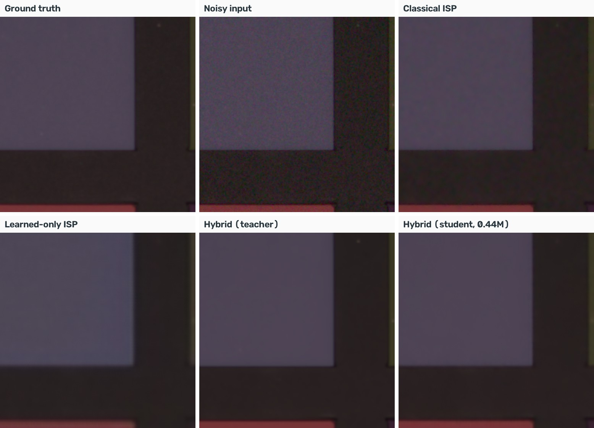

# Hybrid Smartphone ISP

**Computer Vision Hackathon 2026 - Problem P2: Intelligent and computationally efficient smartphone ISP**

**Team T57 - Bit Wizards:** Sanjana B (lead, 1RUA24CSE0408), Saanvi Mahipati (1RUA24CSE0389), Sanjana Gothe (1RUA24CSE0410)

A camera pipeline that turns noisy RAW sensor data into a clean sRGB image by combining **classical ISP stages**
with a **compact learned denoiser**:
* Classical stages: white balance, demosaicing, colour correction, gamma, and a physically based noise model.
* Learned denoiser: a 116 M-parameter teacher, fine-tuned from NAFNet-SIDD, distilled into a **0.44 M-parameter
  student** that runs on a CPU.
* **Adaptive compute**: each image tile gets the cheapest path that is good enough.

**Live demo:** https://sanjanab24--hybrid-isp-web.modal.run



## Results

Held-out camera (SIDD G4, 16 crops of 1024 px):

| Pipeline | PSNR (dB) | SSIM | Delta E 2000 | LPIPS | Params |
|---|---|---|---|---|---|
| Learned-only ISP (end-to-end U-Net) | 33.27 | 0.969 | 3.88 | 0.102 | 29.2 M |
| Classical ISP (guided-filter denoise) | 41.60 | 0.967 | 1.68 | 0.120 | - |
| **Hybrid, teacher** | **46.39** | **0.990** | **0.74** | **0.022** | 116.0 M |
| **Hybrid, student (deployed)** | **45.76** | 0.988 | 0.90 | 0.035 | **0.44 M** |
| Hybrid, student INT8 | 44.32 | 0.978 | 1.16 | 0.030 | 0.44 M |

* The hybrid beats classical by **+4.8 dB** and learned-only by **+13 dB**, with half the colour error of the classical ISP.
* Under 8x sensor noise or 4x under-exposure it stays **7-8 dB** ahead of the traditional ISP
  (`docs/figures/robustness.png`).
* The student runs at **39 ms/MP** on a GPU (FP16). The full app pipeline takes **about 2 s/MP** on 2 CPU threads.
  The model file is 1.87 MB (FP32) or 0.90 MB (INT8).

All numbers are generated by the scripts into `results/*.json` and summarised in [`eval_P2_T57.md`](eval_P2_T57.md).

## Run the app

With Docker:
```bash
docker build -t hybrid-isp . && docker run -p 7860:7860 hybrid-isp
```
Without Docker (Python 3.11):
```bash
pip install -r requirements-app.txt && python app/app.py
```
Then open http://localhost:7860. The app accepts **JPG, PNG, TIFF, HEIC** and **Bayer DNG/RAW**:
* JPG/PNG/TIFF/HEIC photos are converted to a simulated noisy phone RAW, so the original photo serves as the
  reference for the metrics.
* DNG/RAW files go through the real RAW path.

The app only needs ONNX Runtime; no PyTorch is required.

## Reproduce the results

Tested on Windows 11 with an RTX 5050 (8 GB). The paths are PowerShell style; on Linux/macOS use `/`.

**1. Environment**
```bash
pip install torch torchvision --index-url https://download.pytorch.org/whl/cu128
pip install -r requirements.txt
python -m pytest -q
```

**2. Inputs**
* `weights/NAFNet-SIDD-width64.pth` and `weights/NAFNet-SIDD-width32.pth`: from the pretrained-model table of
  [megvii-research/NAFNet](https://github.com/megvii-research/NAFNet). Check them with
  `python -m scripts.fetch_weights --check weights/NAFNet-SIDD-width64.pth --width 64`.
* SIDD RAW and sRGB pairs in the original folder layout (`<scene>/0001_NOISY_RAW_010.MAT`, `..._METADATA_RAW_...`,
  `..._GT_SRGB_...PNG`). We used a 20-pair subset from a Hugging Face mirror:
  `C:\Datasets\SIDD\hf\Raw\train` and `C:\Datasets\SIDD\hf\SRGB\train`.

**3. Data preparation**
```bash
python -m scripts.check_rendering --raw-root C:\Datasets\SIDD\hf\Raw\train --srgb-root C:\Datasets\SIDD\hf\SRGB\train --per-camera 2
python -m scripts.prepare_sidd --raw-root C:\Datasets\SIDD\hf\Raw\train --srgb-root C:\Datasets\SIDD\hf\SRGB\train --out data_shards --test-camera G4 --crops 48
python -m scripts.make_clean_crops --srgb-root C:\Datasets\SIDD\hf\SRGB\train --shards data_shards --out data_shards/clean
```

**4. Training** (about 2 h in total on the RTX 5050)
```bash
# teacher: pretrained NAFNet-SIDD + noise-map input, fine-tuned in fp32
python -m scripts.train --model teacher --width 64 --pretrained weights/NAFNet-SIDD-width64.pth --data data_shards/train --val data_shards/val --use-sidd-srgb --amp none --batch 1 --lr 2e-5 --iters 1500 --freeze-body-iters 300 --val-every 100 --out runs/teacher_fp32
python -m scripts.train --model teacher --resume runs/teacher_fp32/best.pt --data data_shards/train --val data_shards/val --use-sidd-srgb --synthetic data_shards/clean/train --synthetic-mix 0.5 --synthetic-val data_shards/clean/val --amp none --batch 1 --lr 1e-5 --iters 1000 --val-every 100 --val-n 24 --out runs/teacher_mix

# student (0.44 M): distilled from the teacher, then fine-tuned on the real + simulated mix
python -m scripts.train --model student --teacher runs/teacher_fp32/best.pt --distill 1.0 --data data_shards/train --val data_shards/val --use-sidd-srgb --amp bf16 --batch 8 --lr 5e-4 --iters 6000 --val-every 500 --out runs/student_v2
python -m scripts.train --model student --resume runs/student_v2/best.pt --teacher runs/teacher_mix/best.pt --distill 1.0 --data data_shards/train --val data_shards/val --use-sidd-srgb --synthetic data_shards/clean/train --synthetic-mix 0.5 --synthetic-val data_shards/clean/val --amp bf16 --batch 8 --lr 3e-4 --iters 1500 --val-every 250 --val-n 24 --out runs/student_mix

# baseline and ablation
python -m scripts.train --model e2e --width 32 --pretrained weights/NAFNet-SIDD-width32.pth --data data_shards/train --val data_shards/val --batch 4 --lr 2e-4 --iters 3000 --val-every 500 --out runs/e2e
python -m scripts.train --model student --data data_shards/train --val data_shards/val --use-sidd-srgb --amp bf16 --batch 8 --lr 5e-4 --iters 3000 --val-every 500 --out runs/student_nokd
```

**5. Export and INT8**
```bash
python -m scripts.export_onnx --ckpt runs/student_mix/best.pt --out weights/student_fp32.onnx
python -m scripts.quantize --model weights/student_fp32.onnx --out weights/int8/student_int8.onnx --calib data_shards/val --use-sidd-srgb --calib-synthetic data_shards/clean/val
```

**6. Evaluation and report**
```bash
python -m scripts.evaluate --protocol sidd_raw --data data_shards/test --use-sidd-srgb --teacher runs/teacher_mix/best.pt --student runs/student_mix/best.pt --student-int8 weights/int8/student_int8.onnx --e2e runs/e2e/best.pt --student-nokd runs/student_nokd/best.pt --pretrained weights/NAFNet-SIDD-width64.pth --save-examples results/examples
python -m scripts.evaluate --protocol synthetic --images eval_images --teacher runs/teacher_mix/best.pt --student runs/student_mix/best.pt --student-int8 weights/int8/student_int8.onnx --e2e runs/e2e/best.pt
python -m scripts.robustness --data data_shards/test --teacher runs/teacher_mix/best.pt --student-int8 weights/int8/student_int8.onnx
python -m scripts.benchmark --teacher runs/teacher_mix/best.pt --student runs/student_mix/best.pt --e2e runs/e2e/best.pt --onnx weights/student_fp32.onnx weights/int8/student_int8.onnx --app-onnx weights/student_fp32.onnx
python -m scripts.make_eval_md --team T57 --usns "1RUA24CSE0408,1RUA24CSE0389,1RUA24CSE0410"
```

## Repository layout

| Path | Contents |
|---|---|
| `isp/` | Classical ISP (numpy/OpenCV): `bayer`, `demosaic`, `color`, `noise`, `filters`, `pipeline`, `router`, `hybrid`, `raw_io`, `unprocess`, `metrics` |
| `models/` | NAFNet (`nafnet.py`), model factory and pretrained loading (`zoo.py`), losses |
| `data/` | SIDD indexing and crop shards (`sidd.py`), datasets for the training tasks |
| `scripts/` | `check_rendering`, `prepare_sidd`, `make_clean_crops`, `train`, `export_onnx`, `quantize`, `evaluate`, `robustness`, `benchmark`, `make_eval_md`, `fetch_weights`, `deploy_modal` |
| `app/` | Gradio app and demo photos |
| `weights/` | Deployed student `student_fp32.onnx`; INT8 variant in `weights/int8/` |
| `configs/` | Per-camera rendering settings found by `check_rendering` |
| `results/` | Evaluation, robustness and benchmark outputs (JSON) |
| `docs/` | [Architecture](docs/architecture.md), [design document](docs/design_doc.md), [ablations and failure cases](docs/ablation_and_failures.md) |
| `eval_images/` | Unseen test photos for the synthetic protocol |
| `tests/` | Unit tests: CFA handling, demosaicing, noise estimation, unprocessing round trip, router blending, model loading, input errors |

## Deliverables

| Required | Where |
|---|---|
| Live hosted application URL | https://sanjanab24--hybrid-isp-web.modal.run |
| Complete source code | this repository |
| System architecture diagram | [docs/architecture.md](docs/architecture.md) |
| Design document | [docs/design_doc.md](docs/design_doc.md) |
| Comparative evaluation results | [eval_P2_T57.md](eval_P2_T57.md) |
| Ablation study and failure-case analysis | [docs/ablation_and_failures.md](docs/ablation_and_failures.md) |

## Deployment
The live app runs on [Modal](https://modal.com) (2 CPUs, 4 GB RAM, free monthly credits). `scripts/deploy_modal.py`
builds the container from `requirements-app.txt` and ships only the app, the ISP code and the deployed student model:
```bash
pip install modal
modal setup                              # once: log in in the browser
modal deploy scripts/deploy_modal.py     # prints the public URL
```
The container sleeps after 20 minutes without visitors and wakes in about 30-60 s on the next visit.
The same app also runs on any Docker host with the included `Dockerfile`.

## Limitations and ethics
* **Small training set:** 14 SIDD images (4 sensors).
* **The pretrained teacher has seen the SIDD scenes:** "held-out" means held out from our fine-tuning.
* **Fine texture:** on downscaled internet images the compact student over-smooths dense texture.
* **Not evidence:** outputs should not be used as forensic evidence.
* **Privacy:** uploads are processed in memory and not stored.

Details: sections 13-14 of the [design document](docs/design_doc.md).

## AI assistance declaration
We used an AI assistant (Claude, by Anthropic) for system-design discussion, code implementation and debugging, deployment setup, and first drafts of the documentation.
All data preparation, training and evaluation runs, demo photos, design decisions and the final report text are our team's own work, and every number in this report comes from our own runs.

## References
* NAFNet (Chen et al., ECCV 2022)
* SIDD (Abdelhamed et al., CVPR 2018)
* Unprocessing (Brooks et al., CVPR 2019)
* Malvar-He-Cutler demosaicing (ICASSP 2004)
* Guided filter (He et al., TPAMI 2013)
