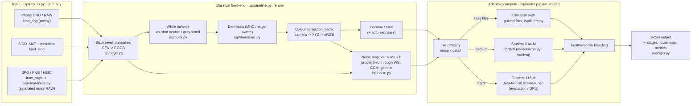
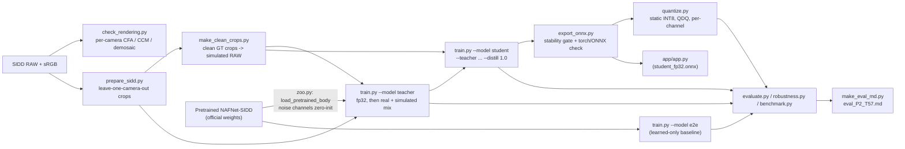

# System architecture

Every box names the module or function that implements it.

## Inference (what the app runs)

`isp/hybrid.py: HybridISP` wires the classical front-end and the router together. The deployed app uses the
classical and student paths. The teacher path is used in evaluation and wherever a teacher ONNX is placed in `weights/`.

## Training and optimisation (offline, `scripts/`)

## Compared variants

| Id | Pipeline | Where |
|---|---|---|
| A | Traditional ISP: our rendering + guided-filter denoise + adaptive sharpening | `isp/pipeline.py: traditional_isp` |
| A2 | Classical denoise on the same input as the hybrid (fair classical baseline) | `isp/router.py` budget `classical_only` |
| B | Learned-only ISP: packed RAW -> sRGB end-to-end | `models/zoo.py: build("e2e")` |
| D0 | Rendering + pretrained NAFNet, no fine-tuning | `--pretrained` in `scripts/evaluate.py` |
| D | Hybrid: rendering + fine-tuned noise-aware teacher | `build("teacher")` |
| E | Hybrid with the distilled student (FP32 / INT8) | `build("student")`, `scripts/quantize.py` |
| F | Adaptive compute: per-tile routing over classical / student / teacher | `isp/router.py` |
