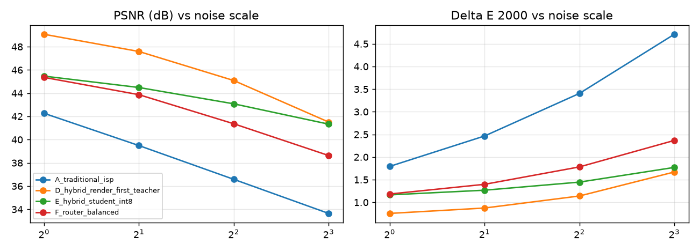

1RUA24CSE0408,1RUA24CSE0389,1RUA24CSE0410

# Evaluation - Problem P2 (Hybrid learned smartphone ISP) - Team T57

All numbers below are generated by `scripts/make_eval_md.py` from `results/*.json`, which are written by `scripts/evaluate.py`, `scripts/benchmark.py` and `scripts/robustness.py`.

## 1. PSNR and SSIM  /  2. Colour accuracy (Delta E 2000)  /  3. LPIPS

### SIDD RAW -> sRGB, held-out camera (unseen sensor)

Device: NVIDIA GeForce RTX 5050 Laptop GPU - images: 16

| Variant | PSNR (dB) ^ | SSIM ^ | Delta E 2000 v | LPIPS v | Latency / image (s) |
|---|---|---|---|---|---|
| noisy_render | 31.05 | 0.7183 | 6.209 | 0.4237 | 0.189 |
| A_traditional_isp | 34.80 | 0.9649 | 3.872 | 0.1435 | 0.345 |
| B_learned_isp_e2e | 33.27 | 0.9685 | 3.880 | 0.1021 | 0.090 |
| noisy_input_sidd_srgb | 32.90 | 0.7185 | 4.862 | 0.4086 | 0.001 |
| A2_classical_guided_tiles | 41.60 | 0.9673 | 1.678 | 0.1200 | 0.407 |
| D0_render_then_pretrained_nafnet | 45.70 | 0.9891 | 0.821 | 0.0232 | 1.500 |
| D_hybrid_render_first_teacher | 46.39 | 0.9902 | 0.739 | 0.0219 | 1.501 |
| E_hybrid_student_fp32 | 45.76 | 0.9878 | 0.902 | 0.0351 | 0.433 |
| abl_E_student_no_distillation | 45.00 | 0.9852 | 0.980 | 0.0420 | 0.433 |
| E_hybrid_student_int8 | 44.32 | 0.9784 | 1.155 | 0.0295 | 1.695 |
| F_router_low | 43.16 | 0.9752 | 1.363 | 0.0715 | 1.052 |
| F_router_balanced | 44.03 | 0.9786 | 1.206 | 0.0472 | 1.514 |
| F_router_high | 45.09 | 0.9832 | 0.986 | 0.0242 | 1.632 |
| abl_F_random_routing_balanced | 43.79 | 0.9777 | 1.226 | 0.0467 | 1.358 |

### SIDD validation sRGB blocks (restoration stage, standard benchmark)

_not run_

### Unseen content: clean photos -> simulated phone RAW at 3 noise levels

Device: NVIDIA GeForce RTX 5050 Laptop GPU - images: 15

| Variant | PSNR (dB) ^ | SSIM ^ | Delta E 2000 v | LPIPS v | Latency / image (s) |
|---|---|---|---|---|---|
| noisy_render | 26.41 | 0.6581 | 6.506 | 0.3560 | 0.047 |
| A_traditional_isp | 30.60 | 0.8532 | 3.381 | 0.1806 | 0.081 |
| B_learned_isp_e2e | 22.02 | 0.6833 | 9.531 | 0.4580 | 0.042 |
| A2_classical_guided_tiles | 31.11 | 0.8517 | 3.366 | 0.1787 | 0.094 |
| D_hybrid_render_first_teacher | 29.82 | 0.8513 | 2.717 | 0.1639 | 0.373 |
| E_hybrid_student_fp32 | 27.83 | 0.7778 | 2.951 | 0.3309 | 0.122 |
| E_hybrid_student_int8 | 27.81 | 0.7727 | 3.075 | 0.3186 | 0.410 |
| F_router_low | 28.85 | 0.8060 | 3.226 | 0.2484 | 0.244 |
| F_router_balanced | 28.51 | 0.7951 | 3.094 | 0.2662 | 0.284 |
| F_router_high | 28.86 | 0.8089 | 2.881 | 0.2492 | 0.379 |
| abl_F_random_routing_balanced | 29.07 | 0.8146 | 2.949 | 0.2451 | 0.273 |

## 4. Model parameters and model size  /  5. Inference latency and memory consumption

Input: 1024x1024 (1.05 MP). Median of repeated runs after warm-up.

| Variant | Params (M) | Size (MB) | Latency median (ms) | Latency p90 (ms) | Peak RAM (MB) | Peak GPU mem (MB) | Device |
|---|---|---|---|---|---|---|---|
| teacher_gpu_fp32 | 115.985 | 463.94 | 755.2 | 756.8 | 1816 | 3014 | NVIDIA GeForce RTX 5050 Laptop GPU |
| teacher_gpu_fp16 | 115.985 | 231.97 | 450.6 | 464.9 | 2176 | 1507 | NVIDIA GeForce RTX 5050 Laptop GPU |
| student_gpu_fp32 | 0.439 | 1.76 | 68.1 | 80.1 | 1069 | 589 | NVIDIA GeForce RTX 5050 Laptop GPU |
| student_gpu_fp16 | 0.439 | 0.88 | 39.3 | 50.4 | 1462 | 295 | NVIDIA GeForce RTX 5050 Laptop GPU |
| student_cpu_torch_fp32 | 0.439 | 1.76 | 1105.1 | 1116.6 | 1927 | - | Intel64 Family 6 Model 186 Stepping 2, GenuineIntel |
| e2e_gpu_fp32 | 29.163 | 116.65 | 73.6 | 78.9 | 1263 | 438 | NVIDIA GeForce RTX 5050 Laptop GPU |
| e2e_gpu_fp16 | 29.163 | 58.33 | 48.7 | 53.3 | 1660 | 219 | NVIDIA GeForce RTX 5050 Laptop GPU |
| onnx_student_fp32.onnx_cpu2t | 0.439 | 1.87 | 1445.7 | 1453.9 | 1144 | - | CPU (16 threads avail, ORT intra=2) |
| onnx_student_int8.onnx_cpu2t | 0.460 | 0.90 | 1199.7 | 1212.9 | 836 | - | CPU (16 threads avail, ORT intra=2) |
| pipeline_classical_only_cpu | - | - | 416.1 | 439.0 | 195 | - | CPU |
| pipeline_student_only_cpu2t | - | - | 1946.4 | 1960.0 | 500 | - | CPU |
| pipeline_low_cpu2t | - | - | 1201.3 | 1234.0 | 496 | - | CPU |

## Robustness under challenging conditions (PSNR dB / Delta E)

| Condition | A_traditional_isp | D_hybrid_render_first_teacher | E_hybrid_student_int8 | F_router_balanced |
|---|---|---|---|---|
| noise_x1 | 42.27 / 1.79 | 49.07 / 0.75 | 45.47 / 1.16 | 45.36 / 1.18 |
| noise_x2 | 39.49 / 2.47 | 47.59 / 0.87 | 44.49 / 1.27 | 43.87 / 1.40 |
| noise_x4 | 36.58 / 3.41 | 45.09 / 1.14 | 43.08 / 1.45 | 41.36 / 1.78 |
| noise_x8 | 33.65 / 4.71 | 41.51 / 1.67 | 41.33 / 1.77 | 38.63 / 2.37 |
| under_x0.5 | 38.22 / 2.85 | 46.17 / 1.01 | 43.71 / 1.37 | 42.70 / 1.58 |
| under_x0.25 | 33.73 / 4.71 | 41.39 / 1.76 | 40.68 / 1.94 | 38.40 / 2.47 |
| wb_err | 30.22 / 6.20 | 31.29 / 5.55 | 31.13 / 5.66 | 30.98 / 5.71 |
| wb_err+grayworld | 28.59 / 10.71 | 28.95 / 10.62 | 29.00 / 10.38 | 28.92 / 10.52 |

## Ablations

Rows prefixed `abl_` in the tables above are separately trained or configured ablations: `abl_*no_noise_map` (teacher fine-tuned identically but without the noise-map input), `abl_*student_no_distillation` (student trained on ground truth only), `abl_F_random_routing_balanced` (router replaced by random tile assignment at the same compute budget). `D0_*` is the pretrained NAFNet before our fine-tuning; `E_student_fp32` vs `E_student_int8` isolates quantisation; `C_*` vs `D_*` compares denoise-before vs denoise-after rendering.

Failure cases and their causes: see `docs/ablation_and_failures.md`.
